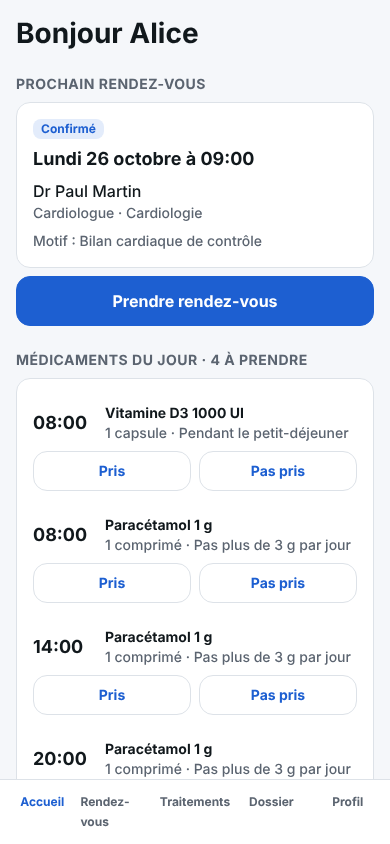
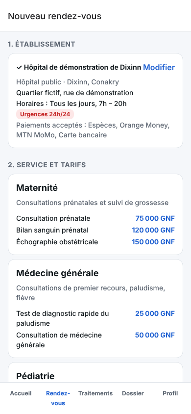
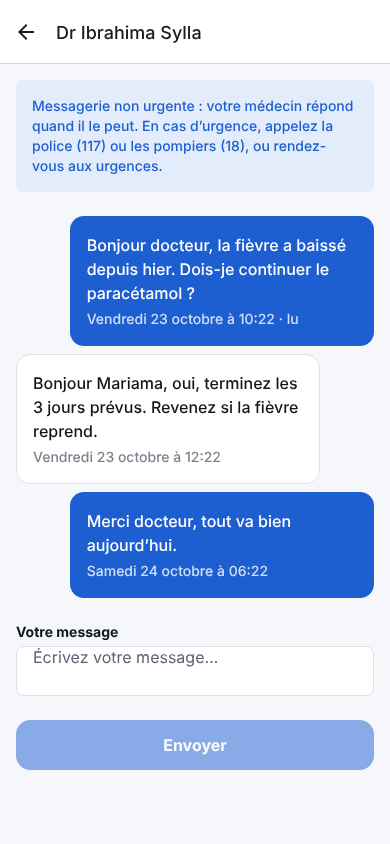
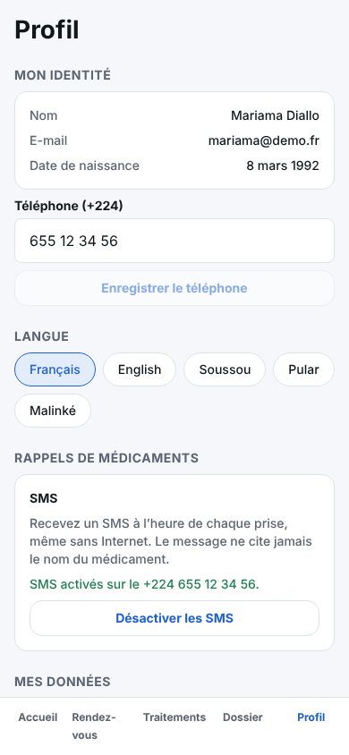
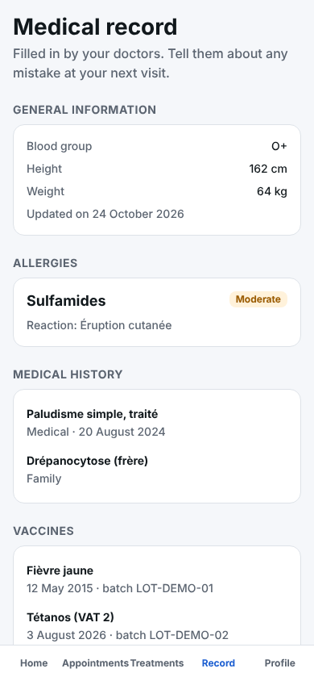
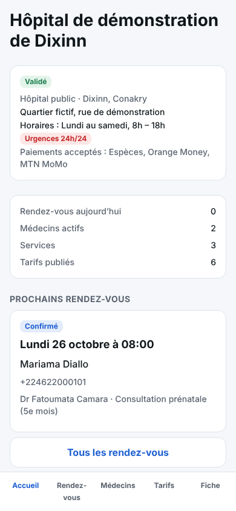
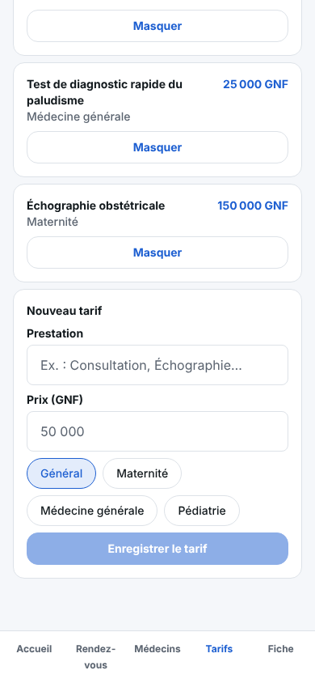
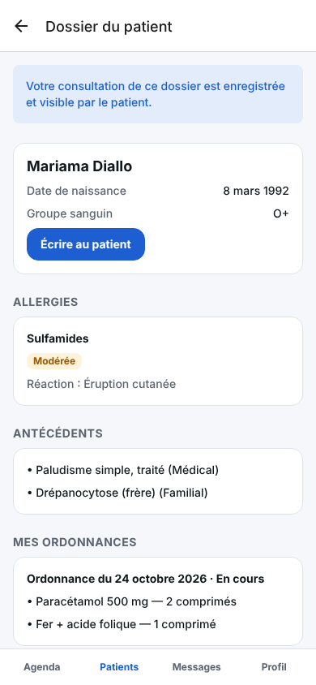
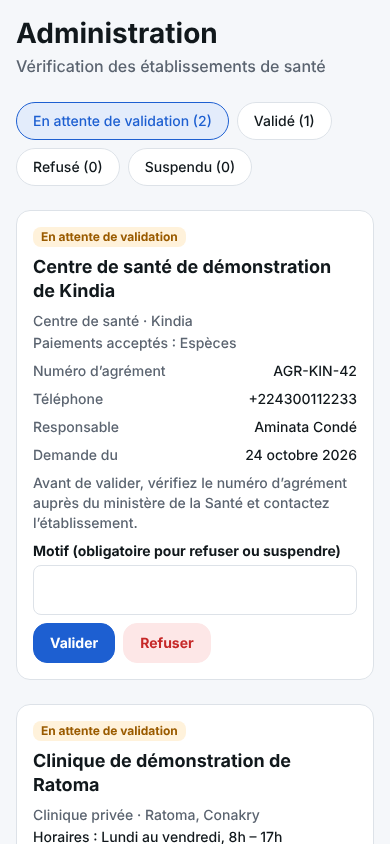

# Hilal Santé — L'app

Application Expo (iOS, Android et web). Chaque compte arrive dans son espace :

**Patient**
- **Accueil** : prochain rendez-vous et médicaments du jour.
- **Rendez-vous** : établissement, puis service (avec les tarifs), médecin et créneau ;
  annulation et historique. Le paiement se fait sur place.
- **Traitements** : plan de prise jour par jour avec « Pris / Pas pris », suivi sur 7 jours, ordonnances.
- **Dossier** : groupe sanguin, allergies, antécédents, vaccins et documents.
- **Profil** : médecin traitant et messagerie, téléphone (+224), langue, rappels par
  notification et par SMS, accès au dossier, export des données, déconnexion.

**Établissement** (hôpital, clinique, centre de santé, cabinet)
- Inscription avec le numéro d'agrément ; le compte reste **en attente** jusqu'à la validation.
- Tableau de bord, rendez-vous de l'établissement, **médecins** (enregistrement avec le
  numéro de l'Ordre, ouverture des créneaux), **services et tarifs**, **fiche** (adresse,
  horaires, urgences 24h/24, moyens de paiement acceptés).

**Médecin** : agenda, patients suivis et leur dossier, messagerie, profil.

**Administrateur** : valide, refuse ou suspend les établissements.

Un médecin n'a pas d'inscription libre : c'est un établissement validé qui l'enregistre avec
son e-mail. S'il n'a pas encore de compte, il le crée ensuite avec ce même e-mail.

**Langues** : français et anglais ; soussou, pular et malinké s'affichent en français tant que
leur traduction n'est pas faite (`src/i18n/guinee.ts`). L'heure affichée est toujours celle de
Conakry, et les numéros d'urgence sont ceux de Guinée (`src/constants/pays.ts`).

## Lancer l'app sur ton téléphone

### 1. Préparer Supabase (une seule fois)
1. Crée un projet sur https://supabase.com.
2. Dans **SQL Editor**, exécute un par un, dans l'ordre, les 8 fichiers de
   `supabase/migrations/` (l'ordre est celui des noms de fichiers).
3. (Facultatif) Exécute `supabase/seed.sql` pour avoir des données de démo : des comptes
   fictifs, tous avec le mot de passe `Demo-Hopital-2026` (liste dans `docs/ARCHITECTURE.md`).
4. Dans **Project Settings → API**, copie l'URL du projet et la clé **publique**
   (publishable / anon). Ne copie **jamais** la clé `service_role`.

### 2. Lancer l'app
```bash
cd apps/mobile
cp .env.example .env      # puis colle l'URL et la clé dans .env
npm install
npx expo start
```
Installe **Expo Go** sur ton téléphone et scanne le QR code affiché. Appuie sur `w` pour
ouvrir la version web (pratique pour les établissements, sur ordinateur).

## Vérifier le code
```bash
npm run typecheck
npm run lint
```

## Organisation
```
src/
├── app/                        Écrans (chaque fichier = une page, Expo Router)
│   ├── _layout.tsx             Qui voit quoi, selon le type de compte
│   ├── connexion, inscription, inscription-etablissement, mot-de-passe-oublie
│   ├── consentement.tsx        Consentement du patient au premier lancement
│   ├── (tabs)/                 Patient
│   ├── etablissement/          Établissement
│   ├── medecin/                Médecin
│   ├── admin/                  Administrateur
│   └── conversation.tsx        Messagerie patient ↔ médecin
├── components/                 Éléments d'interface réutilisables
├── i18n/                       Traductions (fr, en, langues guinéennes)
├── hooks/                      useData (chargement), useTheme, useNow
└── lib/
    ├── supabase.ts             Client Supabase (session dans le trousseau chiffré du téléphone)
    ├── api.ts                  Requêtes du patient
    ├── api-pro.ts              Requêtes des établissements, médecins et de l'administrateur
    ├── hospital-context.tsx    Établissement du gestionnaire connecté
    ├── notifications.ts        Rappels de prise (notifications locales, texte neutre)
    └── auth-context.tsx        Session, profil et consentement
```

## Sécurité
- La session est stockée dans le **trousseau chiffré** du téléphone (Keychain / Keystore).
- L'app ne contient que la clé publique : ce sont les règles RLS de la base qui décident de
  ce que chaque compte peut voir (voir `docs/ARCHITECTURE.md`). Un établissement ne voit
  jamais le contenu médical ; l'administrateur ne voit ni patients ni rendez-vous.
- Les notifications affichent un texte neutre (« Un médicament à prendre »), sans nom de
  médicament, car elles apparaissent sur l'écran verrouillé.

## Captures (version web, données de démo)

| Accueil patient | Réservation et tarifs | Messagerie | Profil et SMS | Dossier en anglais |
|---|---|---|---|---|
|  |  |  |  |  |

| Établissement | Tarifs | Dossier vu par le médecin | Administrateur |
|---|---|---|---|
|  |  |  |  |
