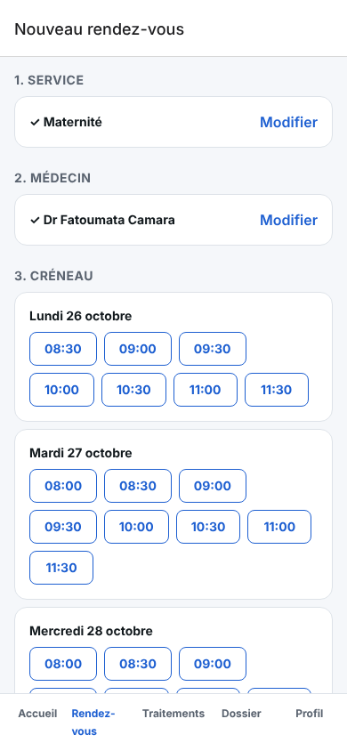
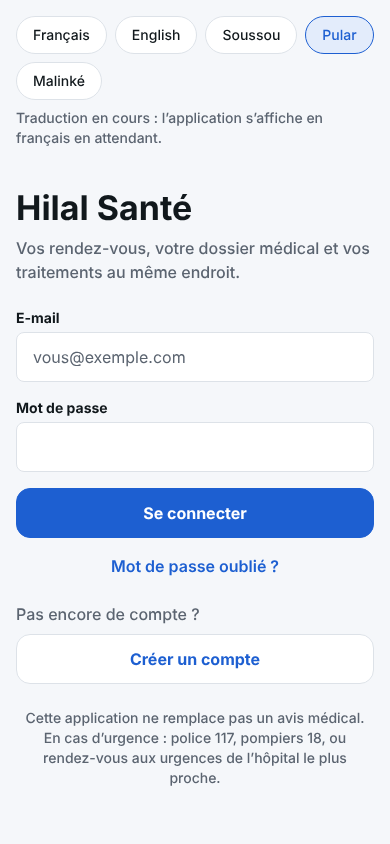

# Hilal Santé — App mobile patient

Application iOS / Android (Expo) pour les patients :

- **Accueil** : prochain rendez-vous et médicaments du jour.
- **Rendez-vous** : prise de rendez-vous (service, puis médecin, puis créneau), annulation et historique.
- **Traitements** : plan de prise jour par jour avec les boutons « Pris / Pas pris », suivi sur 7 jours et ordonnances.
- **Dossier** : groupe sanguin, allergies, antécédents, vaccins et documents.
- **Profil** : téléphone (+224), langue, rappels par notification et par SMS, liste des personnes qui ont consulté le dossier, export des données et déconnexion.

**Langues** : français et anglais ; soussou, pular et malinké s'affichent en français tant que
leur traduction n'est pas faite (`src/i18n/guinee.ts`). L'heure affichée est toujours celle de
Conakry, et les numéros d'urgence sont ceux de Guinée (`src/constants/pays.ts`).

À la première connexion, le patient doit donner son consentement. Les comptes soignants
sont redirigés : l'app est réservée aux patients.

## Lancer l'app sur ton téléphone

### 1. Préparer Supabase (une seule fois)
1. Crée un projet sur https://supabase.com.
2. Dans **SQL Editor**, exécute dans l'ordre les fichiers de `supabase/migrations/` (de 1 à 4).
3. (Facultatif) Exécute `supabase/seed.sql` pour avoir des données de démo. Ce sont 6 comptes
   fictifs, tous avec le mot de passe `Demo-Hopital-2026`. Le compte patient est `mariama@demo.fr`.
4. Dans **Project Settings → API**, copie l'URL du projet et la clé **publique**
   (publishable / anon). Ne copie **jamais** la clé `service_role`.

### 2. Lancer l'app
```bash
cd apps/mobile
cp .env.example .env      # puis colle l'URL et la clé dans .env
npm install
npx expo start
```
Installe **Expo Go** sur ton téléphone et scanne le QR code affiché.

## Vérifier le code
```bash
npm run typecheck
npm run lint
```

## Organisation
```
src/
├── app/                    Écrans (chaque fichier = une page, Expo Router)
│   ├── _layout.tsx         Qui voit quoi : connexion, consentement, ou onglets
│   ├── connexion.tsx, inscription.tsx, mot-de-passe-oublie.tsx
│   ├── consentement.tsx    Consentement au premier lancement
│   └── (tabs)/             Accueil, rendez-vous, traitements, dossier, profil
├── components/             Éléments d'interface réutilisables
├── i18n/                   Traductions (fr, en, langues guinéennes)
├── hooks/                  useData (chargement), useTheme, useNow
└── lib/
    ├── supabase.ts         Client Supabase (session dans le trousseau chiffré du téléphone)
    ├── api.ts              Toutes les requêtes vers la base
    ├── notifications.ts    Rappels de prise (notifications locales, texte neutre)
    └── auth-context.tsx    Session, profil et consentement
```

## Sécurité
- La session est stockée dans le **trousseau chiffré** du téléphone (Keychain / Keystore).
- L'app ne contient que la clé publique : ce sont les règles RLS de la base qui décident de
  ce que chaque utilisateur peut voir (voir `docs/ARCHITECTURE.md`).
- Les notifications affichent un texte neutre (« Un médicament à prendre »), sans nom de
  médicament, car elles apparaissent sur l'écran verrouillé.

## Captures (version web, données de démo)

| Accueil | Rendez-vous | Profil et SMS | Choix de la langue | Dossier en anglais |
|---|---|---|---|---|
|  |  |  |  |  |
